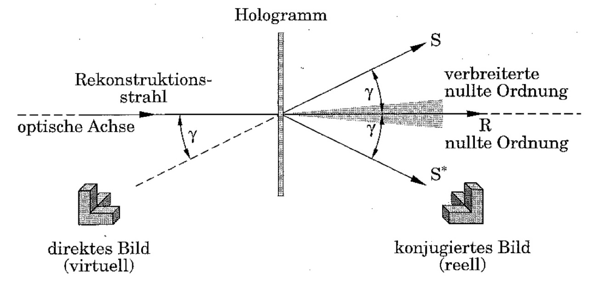

# 01 – Holography

**Advanced lab course, FSU Jena · Nov. 2025 · with Lisa · supervisor: Dr. S. Schmidl**

**Grade: 1.33** (theory test 1.3 · experimental work 1.5 · report 1.2; German scale, 1.0 = best)

## What we did
- Built a **Michelson interferometer** with a HeNe laser (632.8 nm) to check stability and coherence length; the path difference of a full table length stayed within the coherence length, and a beat between the superposed beams was observed.
- Set up a **spatial filter** to produce clean plane waves and recorded **transmission holograms** of transparent and reflecting objects, **white-light reflection holograms** and a **holographic sine grating** on photographic plates, including chemical development.
- **Holographic interferometry:** counted 59 interference fringes to determine the tilt angle of an object between two exposures.

## Results
- Grating constant of the holographic sine grating, measured two independent ways:
  - from the first-order diffraction angle: **g = 0.860 ± 0.003 µm**
  - from microscope images of the grating: **g = 0.864 ± 0.014 µm**
- White-light reflection holograms appeared green to blue instead of red, because the emulsion shrank during development and reduced the fringe-plane spacing.

## Files
- `figures/`: photos of the setups, holograms, reconstruction and the microscope image of the sine grating

No analysis code for this experiment: the evaluation was done by hand from photos and microscope images.
