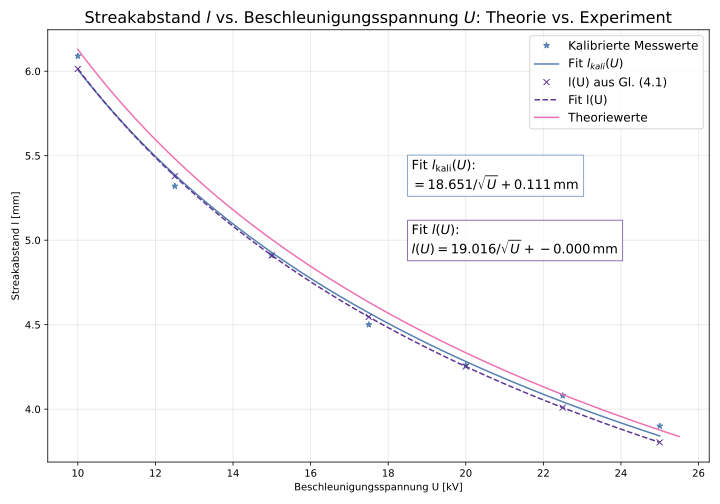

# Electron Diffraction (RHEED) on Ag(100)

**Advanced lab course, FSU Jena · Dec. 2025 · with Lisa · supervisor: Dr. M. Grünewald**

**Grade: 1.23** (theory test 1.7 · experimental work 1.0 · report 1.0; German scale, 1.0 = best)

## What we did
Reflection high-energy electron diffraction (RHEED) on a silver single crystal in ultra-high vacuum:
1. Identified the two high-symmetry directions of the fcc surface by rotating the sample.
2. Varied the **acceleration voltage (10–25 kV)** and the **angle of incidence**.
3. **Sputtered** the surface with ions, then **annealed** it while recording the diffraction pattern.
4. Studied the effect of **electron irradiation** on the pattern.
5. **Evaporated KCl** onto Ag(100) and followed the epitaxial growth in the RHEED pattern.

## Analysis
- Fitted the streak spacing with the de Broglie relation, *l(U) = a/√U + b*, for raw and calibrated data and compared with theory (`FP_theorie3_real_UA.py`, `FP_EB_Spannung_*.py`).
- Extracted line profiles from the RHEED images (grey values) and tracked peak, background and mean intensity during annealing, electron irradiation and two deposition phases (`FP_EB_Ausheilen_*.py`, `FP_EB_Elektronenbeschuss*.py`, `*Bedampfung*.py`).
- Compared streak spacings of substrate (Ag) and adsorbate (KCl) to discuss the epitaxial relation (`epexierelation.py`).

## Results
- Sputtering roughened the surface: streaks turned into spot-like reflections (3D topography). After annealing the streak pattern returned with better quality and less noise than before.
- With increasing KCl coverage, additional KCl features appeared and the Ag streaks weakened, which shows epitaxial growth.

## Files
- `analysis/`: Python scripts and the CSV data they read
- `figures/`: plots used in the report
