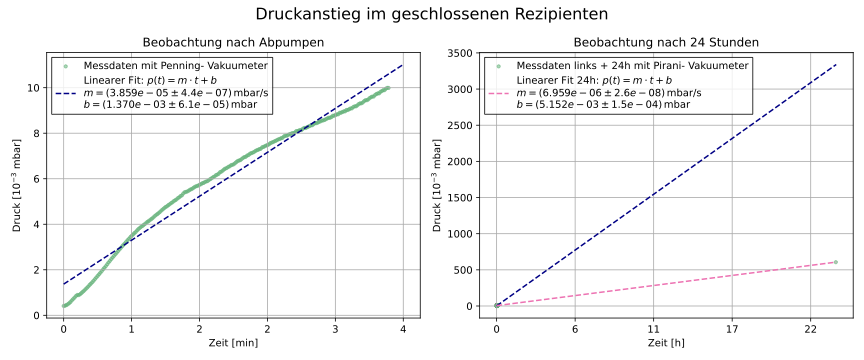

# 03 – Vacuum Technology and Thin-Film Evaporation

**Advanced lab course, FSU Jena · Jan. 2026 · team of two**

## What we did
- Pumped down a vacuum chamber with a **rotary-vane pump** and a **turbomolecular pump** and recorded the pump-down curves.
- Measured the **pressure rise** of the closed chamber over 20 min and 24 h to determine the leak rate.
- Evaporated **copper and tin films** onto glass, measured film thickness **in situ (quartz crystal)** and **ex situ (interference microscope, step mask)**, and recorded the **resistance during growth** of contact strips.

## Analysis
- Exponential fits *p(t) = p_end + p₀·e^(−At)* of the pump-down curves (`abpumpkurve Verdränger`, `Abpumpkurve Turbo`).
- Linear fits of the pressure rise to separate real and virtual leaks (`Dichtheit_Rezipient_*.py`).
- Resistance R(d) and R(t) of growing Cu, Sn and Cu/Sn ("bronze") layers (`Leitfähigkeit_*.py`).
- Sine fits to interference-microscope line profiles to get the film thickness (`Mikroskop_Draht.py`).

## Results
- Pumping speeds: **3.94 L/s** (rotary vane) and **71.7 L/s** (turbomolecular pump).
- The pressure rise showed both real and virtual leaks.
- Comparing quartz-crystal and microscope thickness revealed a wrong **tooling factor**; the corrected factor gave plausible film thicknesses.
- Copper contacts needed a minimum thickness of about **60 nm** to conduct. A growing Sn layer on Cu acts as a parallel resistor and lowers the total resistance.

## Files
- `analysis/`: Python scripts and the CSV data they read
- `figures/`: plots used in the report
