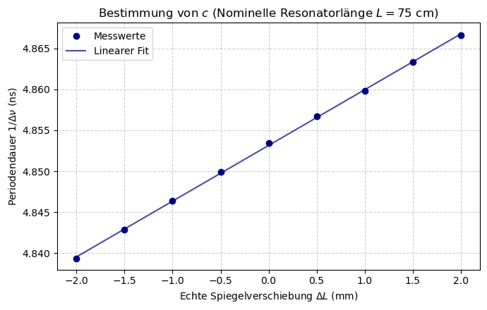

# 04 – HeNe Gas Laser

**Advanced lab course, FSU Jena · Apr. 2026 · with Nelly · supervisor: Dr. J. Hein**

## What we did
- Aligned an open HeNe resonator and generated **transverse modes up to TEM₄₀**; measured the output power per mode.
- Measured the **beam waist** inside and outside the resonator for different resonator lengths.
- Measured the **beat frequency of neighbouring longitudinal modes** while changing the resonator length, to determine the speed of light.

## Analysis
- **Gaussian-beam / ABCD-matrix model:** the output coupler acts as a plano-concave lens. Back-propagating the far-field radii with ABCD matrices gave waist radii that match theory; pure free-space propagation gave systematically too small values (`gaslaser_2.ipynb`).
- **Linear regression** of 1/Δν against mirror displacement at L ≈ 50 cm and 75 cm, with error propagation.

## Results
- **c = (2.98 ± 0.03)·10⁸ m/s** from the longitudinal-mode beat, plus the effective optical resonator length (longer than the geometric length because of the mirrors, Brewster windows and gas).
- Output power drops almost linearly with mode order, from **0.40 mW (TEM₀₀)** to 0.01 mW (TEM₄₀).

## Files
- `analysis/`: Jupyter notebooks and the measured values (`GL - Messwerte.xlsx`)
- `figures/`: plots exported from the notebooks
