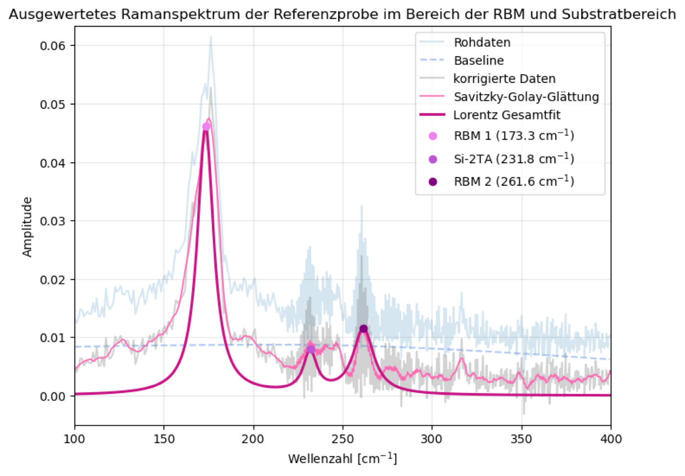

# 05 – Raman Spectroscopy of Carbon Nanostructures

**Advanced lab course, FSU Jena · June 2026 · with Nelly · supervisor: Dr. M. Grünewald**

**Grade: 1.67** (theory test 1.3 · experimental work 2.0 · report 1.7; German scale, 1.0 = best)

## What we did
- Calibrated a **Raman microscope** with standard samples and studied the effect of exposure time.
- Measured **carbon-nanotube (CNT) reference samples** at several positions (on the support cross, on PET, on a bridge) to analyse quality, density and homogeneity.
- Ran the **CVD growth of CNTs** twice. Neither run produced usable nanotubes, so the CNT analysis used reference samples.
- Compared **amorphous and crystalline SiO₂**, graphite and a commercial **aspirin** tablet.

## Analysis
- **Asymmetric least-squares (ALS) baseline** correction with sparse matrices, **Savitzky–Golay** smoothing, `find_peaks`.
- Single and **triple-Lorentz fits** of the RBM, D, G and 2D bands; peak ratios I_D/I_G (defect density) and I_G/I_Si (local density).
- Diameter from the radial breathing mode, *d = A/ω_RBM* with A = 248 nm·cm⁻¹.

## Results
- G-band splitting distinguishes CNTs from graphite (curvature of the graphene sheets).
- RBM peaks at 173 cm⁻¹ and 262 cm⁻¹ give tube diameters of **≈ 1.43 nm and ≈ 0.95 nm**.
- Amorphous quartz glass shows a broad continuum, crystalline quartz sharp peaks (long-range order).
- Aspirin bands assigned to the functional groups of acetylsalicylic acid.
- Limitation: no intensity calibration of the spectrometer, so amplitudes of far-apart bands are only qualitatively comparable.

## Files
- `analysis/`: notebooks per sample and the spectra they read (`.txt`, fit results as `.npz`)
- `figures/`: fitted spectra
