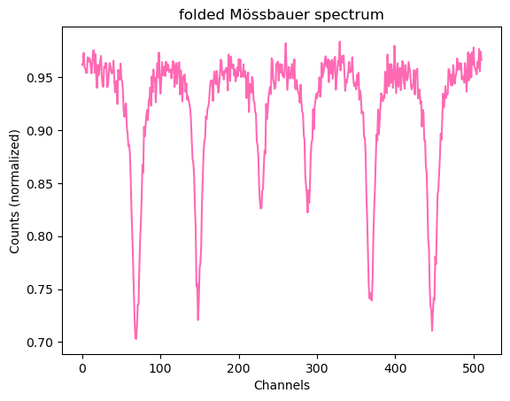

# 06 – Mössbauer Spectroscopy of Iron and Stainless Steel

**Advanced lab course, FSU Jena · May 2026 · with Nelly · supervisor: Dr. S. Sadashivaiah**

## What we did
- Estimated the upper radiation dose and recorded the **γ-spectrum of a ⁵⁷Co source** with a proportional counter and multichannel analyser.
- Set the single-channel-analyser window on the **14.4 keV** Mössbauer line.
- Recorded Mössbauer spectra of **α-Fe** with triangular and sinusoidal velocity drive, and of **stainless steel** (3.5 h).

## Analysis
- **Own Python analysis** (`möss_auswertung.ipynb`, `möss_besser.py`): folding of the raw spectrum, peak finding and a six-Lorentzian sextet fit.
- **Velocity calibration and transmission fits with [Nuclear NEXUS](https://fs-mcp.pages.desy.de/nuclear-nexus/)** (`nb_velocity_calibration*.ipynb`, `nb_fit_sample.ipynb`). These notebooks are adapted from the official NEXUS example *Evaluation of a Mössbauer spectrum*. We corrected the sinusoidal-drive spectrum for the non-uniform dwell time of the source.

## Results
- α-Fe shows the expected **Zeeman sextet** (magnetic hyperfine field, no quadrupole splitting in the cubic lattice).
- Triangular drive gives a flat baseline but mechanical oscillations at the turning points; sinusoidal drive avoids them but needs a baseline correction.
- **Stainless steel** is **82 % paramagnetic** (doublet) and **18 % ferromagnetic** (weak sextet with reduced B_hf = 20.9 ± 0.1 T). Its lines are about **6× broader** than natural width, because the alloy gives each Fe atom a different local environment.

## Files
- `analysis/`: notebooks, script and raw spectra (`.ws5`)
- `figures/`: folded spectrum, calibration and fit plots

**Not included:** `möss_besser.py` reads the 30-minute ⁵⁷Co energy spectrum (`20260512.30_minuten_mcs.ws5`), which was not in the course folder. Add it to `analysis/` to run the script.
