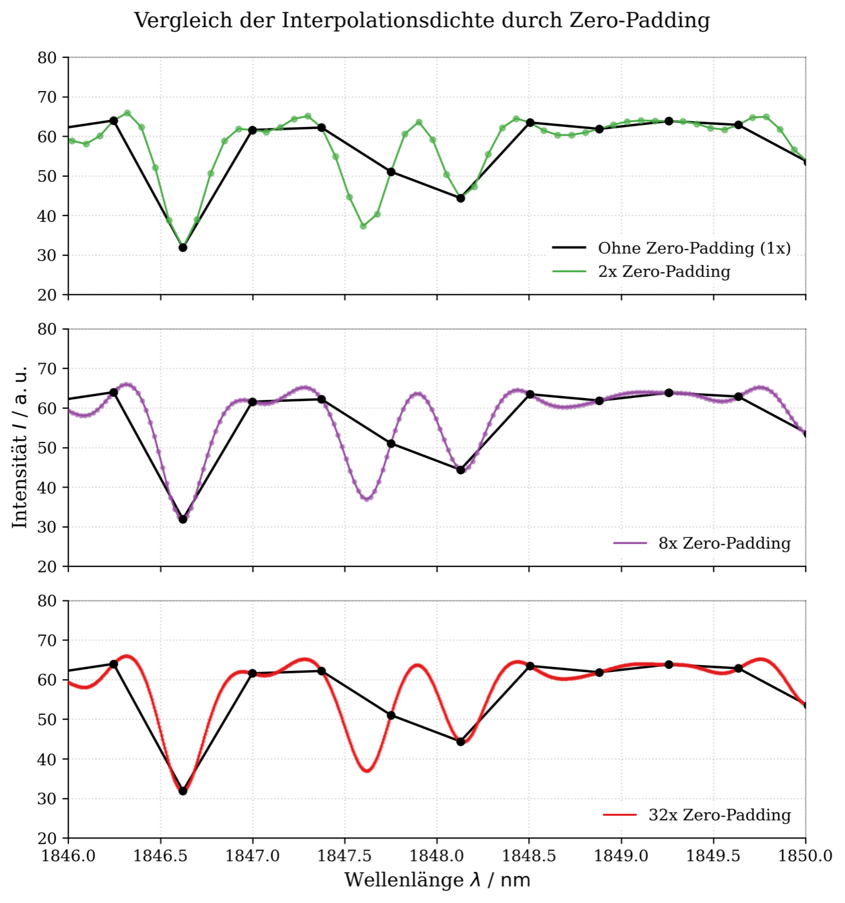

# Seminar: Optical Fourier-Transform Spectroscopy

**Seminar, FSU Jena · July 2026 · individual project (measurements, analysis and talk done on my own) · supervisor: Dr. S. Schmidl**

## What I did
- Computed spectra from **interferograms** of a sodium lamp and a tungsten lamp with my own FFT code.
- Measured the **sodium D doublet** (589.0 / 589.6 nm) at different mirror travel distances to find the **resolution limit**: the doublet needs an optical path difference of about 0.6 mm (Δν̃ ≈ 17.2 cm⁻¹).
- Studied **apodisation** (triangle window) and **zero-padding** (1× to 32×).
- Compared the **tungsten-lamp spectrum** with Planck's law (T ≈ 2700 K) and an LED spectrum.
- Recorded the **NIR transmission spectrum of benzene** with an FTIR system and compared it with the literature.
- Presented everything in a 28-slide seminar talk.

## Files
- `analysis/`: notebooks (interferogram → spectrum, resolution, LED, tungsten/benzene, FTIR) and the measurement data
- `figures/`: selected plots

**Not included:** zero-padded spectra larger than 5 MB (regenerate them with `seminar_FT_IR.ipynb`) and the raw sodium/LED spectra read by `seminar_auflösung_na.ipynb` and `seminar_led.ipynb`, which were not in the course folder.
