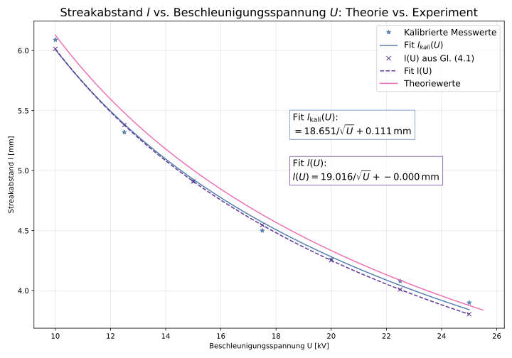

# Advanced Physics Lab – FSU Jena

Six experiments and one seminar project from the final year of my B.Sc. in Physics at Friedrich Schiller University Jena (2025–2026): from holograms and lasers to electrons diffracting off a crystal surface and gamma rays probing the magnetism of iron.

<p align="center">
  
  
</p>

## About the course

The *Fortgeschrittenenpraktikum* (advanced lab course) is where physics students in Jena work with real research equipment: vacuum chambers, open laser resonators, Raman microscopes, radioactive sources. Each experiment runs over several days in a team of two. It starts with a **theory test**, followed by the **experiment** itself, and ends with a **written report** of 25–50 pages in the style of a scientific paper. All three parts are graded.

I did the experiments with my lab partners Lisa (holography, RHEED, vacuum) and Nelly (gas laser, Raman, Mössbauer). The seminar on Fourier-transform spectroscopy was an individual project: measurements, analysis and a 28-slide talk.

**Final grade: 1.3 in both lab modules** (German scale, 1.0 = best).

## Experiments

| Experiment | What it is about | Highlight | Grade |
|---|---|---|---|
| [**Holography**](holography) | Recording 3D images with laser light on photographic plates | Grating constant measured two independent ways: 0.860 µm vs. 0.864 µm | 1.33 |
| [**Electron diffraction (RHEED)**](electron-diffraction-rheed) | Watching a silver crystal surface roughen, heal and grow a salt layer, live in ultra-high vacuum | Wave nature of electrons: streak spacing follows 1/√U | 1.23 |
| [**Vacuum & thin films**](vacuum-and-thin-films) | Building a vacuum, then coating glass with metal layers only nanometres thick | Pumping speeds of 3.9 L/s and 72 L/s; films conduct from ~60 nm | 1.0 |
| [**HeNe gas laser**](hene-gas-laser) | Opening up a laser to shape its beam and its modes | Speed of light from the laser's mode beat: (2.98 ± 0.03)·10⁸ m/s | 1.33 |
| [**Raman spectroscopy**](raman-spectroscopy) | Identifying materials by how they scatter laser light | Carbon-nanotube diameters of 0.95 nm and 1.43 nm | 1.67 |
| [**Mössbauer spectroscopy**](moessbauer-spectroscopy) | Using gamma rays to feel the magnetic field at an iron nucleus | Stainless steel: 82 % non-magnetic, 18 % magnetic phase | 1.1 |
| [**Seminar: Fourier-transform spectroscopy**](seminar-fourier-spectroscopy) | Turning an interference pattern into a spectrum | Resolving the two yellow sodium lines, 0.6 nm apart | – |

## What I learned

- **Experimental physics:** ultra-high vacuum, thin-film deposition, electron diffraction, laser alignment, Raman micro-spectroscopy, γ-spectroscopy, holography, FT/FTIR spectroscopy
- **Data analysis in Python:** non-linear fits with uncertainties (`curve_fit`, ODR), baseline correction, smoothing and peak finding, multi-Lorentzian spectral fits, Fourier transforms and windowing, error propagation
- **Scientific software:** [Nuclear NEXUS](https://fs-mcp.pages.desy.de/nuclear-nexus/) (DESY) for Mössbauer spectra, Jupyter, NumPy, SciPy, pandas, Matplotlib
- **Scientific writing:** six full lab reports and a seminar talk

## Repository layout

Each experiment has its own folder with a short explanation (`README.md`), the analysis code with the measurement data (`analysis/`) and the plots (`figures/`). The notebooks are saved with their outputs, so the results can be read directly on GitHub.

```bash
pip install -r requirements.txt
cd hene-gas-laser/analysis && jupyter lab
```

Code comments and plot labels are in German, the language of the lab reports.
