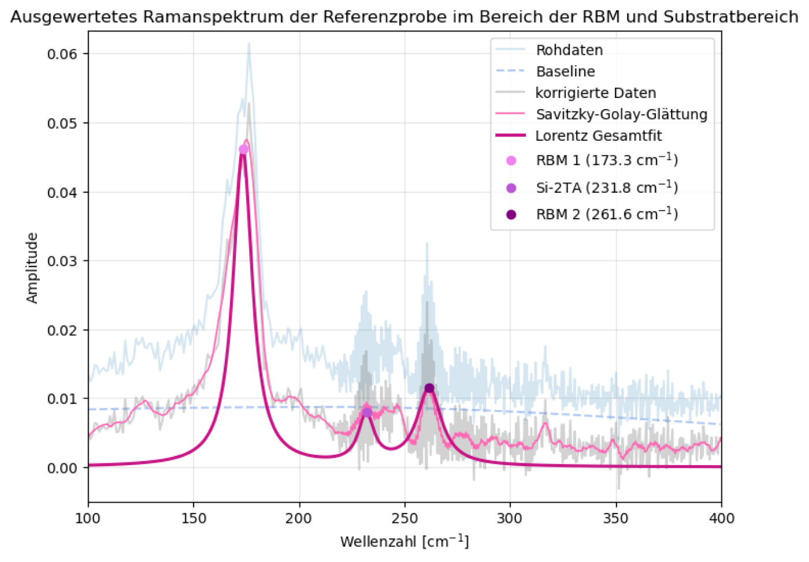

# Advanced Physics Lab – FSU Jena

Data analysis from my advanced lab course (*Fortgeschrittenenpraktikum*) and a seminar on Fourier-transform spectroscopy, B.Sc. Physics at Friedrich Schiller University Jena (2025–2026).

Each experiment was a multi-day team experiment (teams of two) with a written report of 25–50 pages. This repository collects the **Python analysis**: fits with uncertainties, signal processing, baseline correction, spectral fitting and the figures that went into the reports.

<p align="center">
  
  
</p>

## Experiments

| # | Experiment | Physics | Analysis highlights |
|---|---|---|---|
| 01 | [Holography](01-holography) | Coherence, transmission/reflection/white-light holograms, holographic interferometry | Grating constant from diffraction angle vs. microscopy: 0.860 ± 0.003 µm vs. 0.864 ± 0.014 µm |
| 02 | [Electron diffraction (RHEED)](02-electron-diffraction-rheed) | Ag(100) surface in UHV: sputtering, annealing, KCl epitaxy | 1/√U fits of streak spacing, intensity profiles during annealing, electron irradiation and deposition |
| 03 | [Vacuum & thin films](03-vacuum-and-thin-films) | Rotary-vane and turbomolecular pumps, leak rate, Cu/Sn evaporation | Pumping speeds (3.94 L/s and 71.7 L/s) from exponential fits; real vs. virtual leaks; R(d) of growing films |
| 04 | [HeNe gas laser](04-hene-gas-laser) | Transverse modes, Gaussian beams, ABCD matrices, longitudinal-mode beat | Speed of light from mode beat frequencies: **c = (2.98 ± 0.03)·10⁸ m/s** |
| 05 | [Raman spectroscopy](05-raman-spectroscopy) | Carbon nanotubes, SiO₂ (amorphous vs. crystalline), aspirin, graphite | ALS baseline, Savitzky–Golay smoothing, multi-Lorentz fits; CNT diameters ≈ 0.95 nm and 1.43 nm from RBM |
| 06 | [Mössbauer spectroscopy](06-moessbauer-spectroscopy) | ⁵⁷Fe hyperfine interactions in α-Fe and stainless steel | Velocity calibration and transmission fits with Nuclear NEXUS; stainless steel: 82 % paramagnetic / 18 % ferromagnetic |
| 07 | [Seminar: Fourier-transform spectroscopy](07-seminar-fourier-spectroscopy) | Interferograms, resolution limit, apodisation, zero-padding | Na D doublet resolution vs. mirror travel, tungsten lamp vs. Planck (2700 K), benzene NIR transmission |

## Methods and tools

- **Python:** NumPy, SciPy (`curve_fit`, ODR, `find_peaks`, `savgol_filter`, sparse ALS baseline), pandas, Matplotlib, Jupyter
- **Spectroscopy software:** [Nuclear NEXUS](https://fs-mcp.pages.desy.de/nuclear-nexus/) (DESY) for Mössbauer fits
- **Lab techniques:** UHV and vacuum technology, RHEED, thermal evaporation, quartz-crystal and interference-microscope thickness measurement, Raman micro-spectroscopy, CVD, γ-spectroscopy (proportional counter, SCA/MCA), HeNe resonator alignment, holography, FT/FTIR spectroscopy

## Running the code

```bash
pip install -r requirements.txt
cd 04-hene-gas-laser/analysis
jupyter lab
```

Each `analysis/` folder contains the scripts or notebooks together with the measurement data they read, so they run from inside that folder. The Mössbauer notebooks additionally need Nuclear NEXUS. Code comments and plot labels are mostly in German, as the reports were written in German.

## Notes

- These were team experiments. The analysis code here is the code we used for the reports; the reports themselves are not included.
- Some very large derived data files (zero-padded spectra, > 5 MB) are not included; see the seminar folder.
