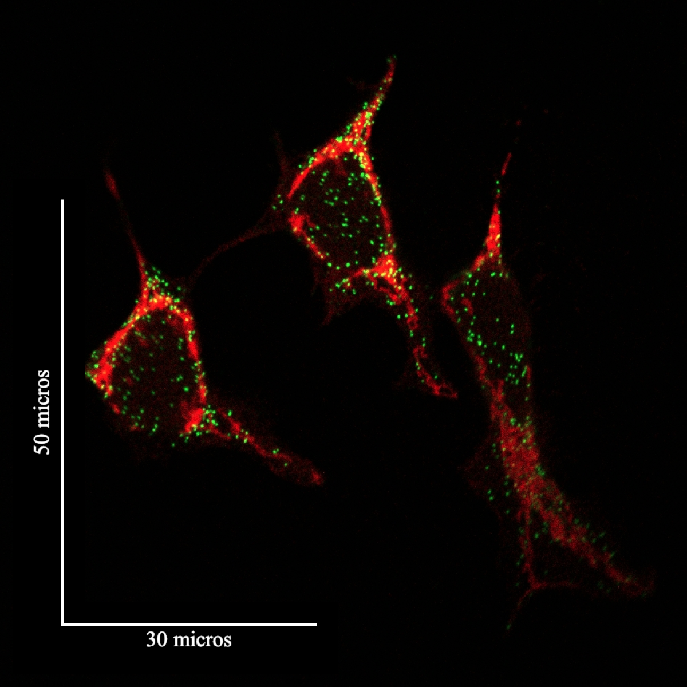
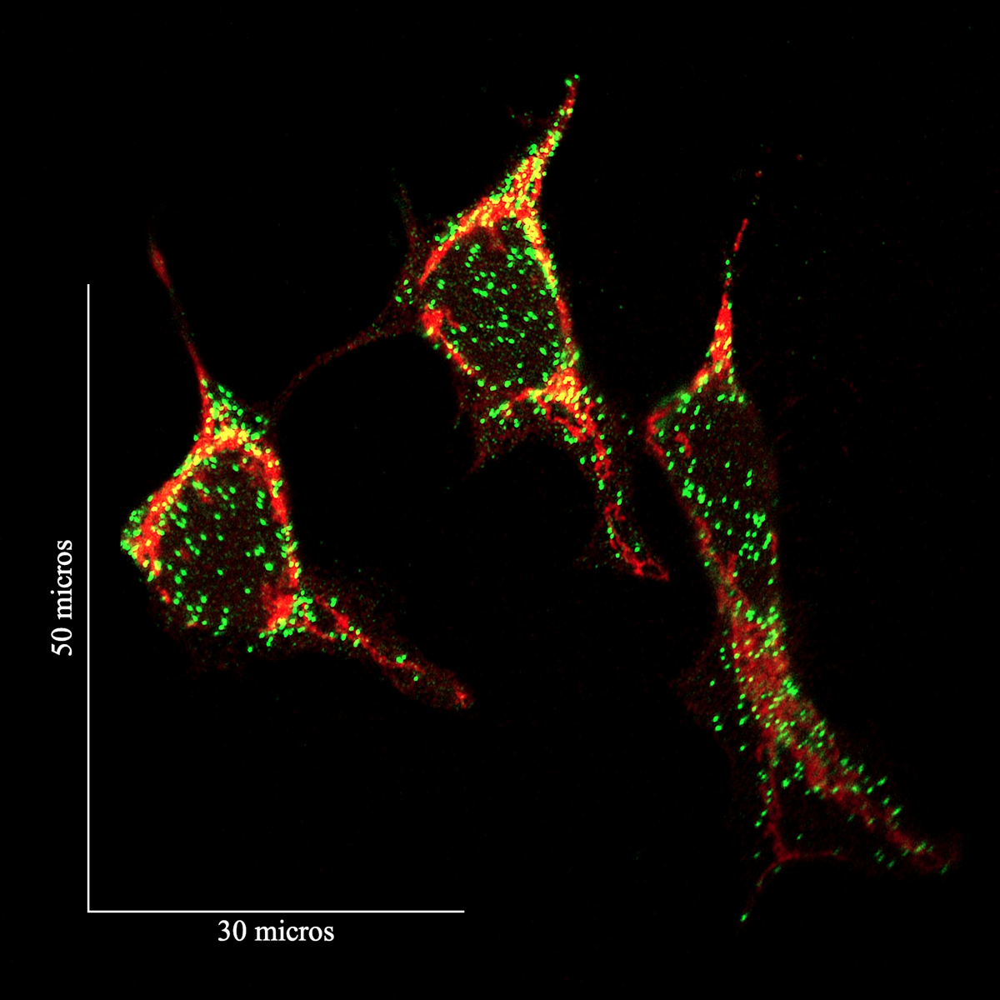
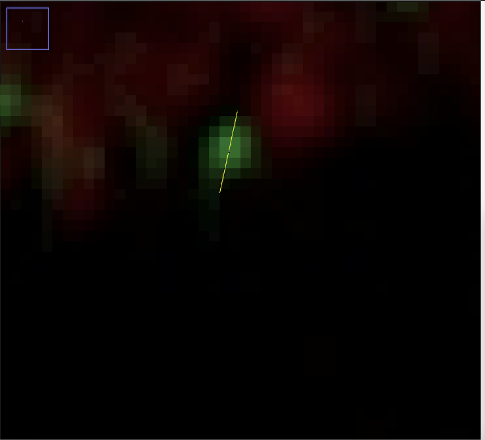
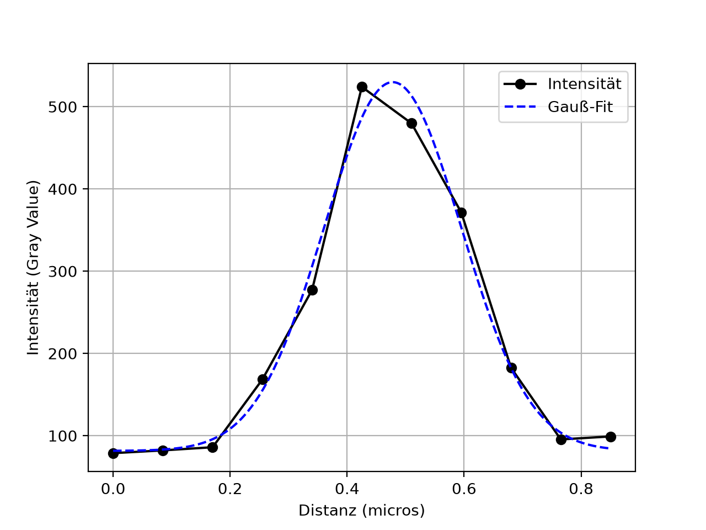
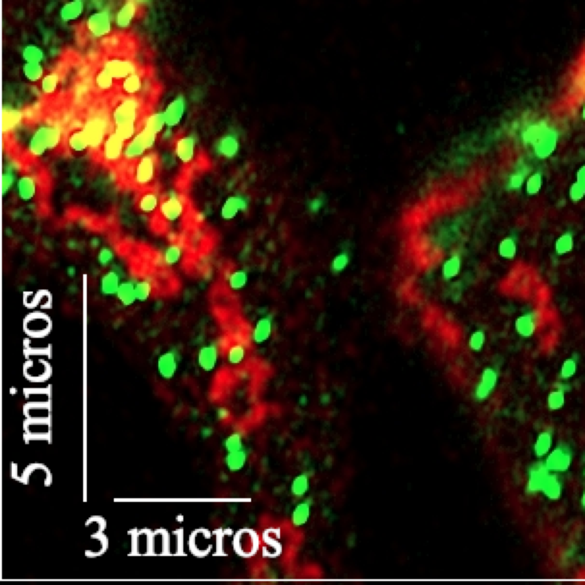
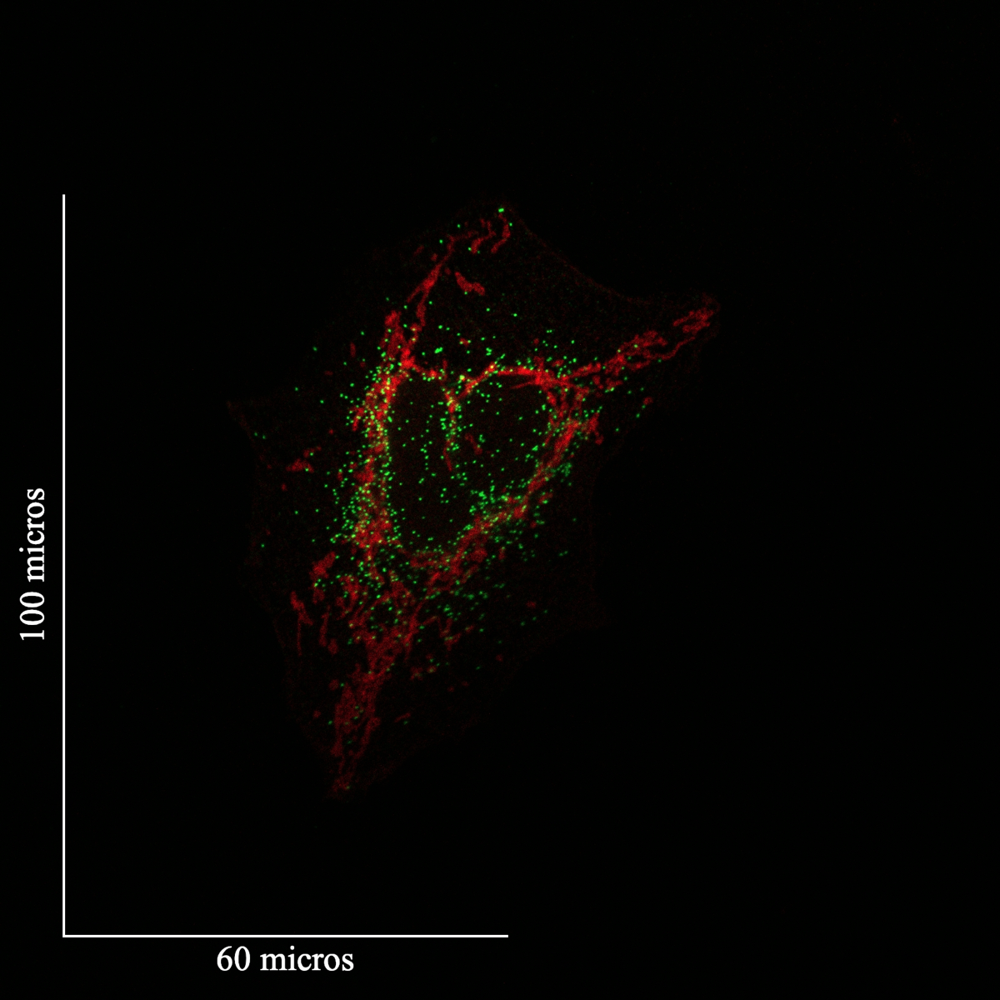

# Confocal vs. Airyscan: Resolution Limits in Fluorescence Microscopy

*Biophysics lab project, FSU Jena · summer 2025 · with Agnese and Zineb · supervisor: Dr. K. Reglinski*

📄 **[Full lab report (PDF, German)](report.pdf)**

  
  

<em>The same cells, imaged twice. Left: confocal. Right: Airyscan. Red: mitochondria, green: peroxisomes.</em>

## The idea
A light microscope cannot show details much smaller than about half the wavelength of light (the **Abbe limit**, roughly 200–250 nm for a confocal microscope). Two tiny structures closer than that blur into one spot.

- A **confocal microscope** scans a focused laser across the sample and uses a pinhole to block out-of-focus light, giving sharp optical sections.
- **Airyscan** replaces the pinhole with an array of 32 detectors that each see a slightly different part of the blurred spot (the Airy disk). Combining them computationally pushes the resolution beyond the classical confocal limit.

Our question: **how much better is Airyscan in practice?**

## What we did
- Used human cells (HEK) and stained two organelles by **immunofluorescence**: mitochondria (anti-TOM20, AbStar Red) and peroxisomes (anti-PMP70, Alexa 488). This involved fixing, permeabilising, blocking and two rounds of antibody incubation.
- Imaged the same cells with a **Zeiss confocal microscope** and its **Airyscan** detector, including z-stacks and close-ups.
- Peroxisomes are smaller than the resolution limit, so their image is essentially the microscope's **point spread function (PSF)**: ideal test objects.

## How we analysed it
- Drew **line profiles** across single peroxisomes in Fiji and fitted a **Gaussian** to each profile.
- Resolution from the width of the fit: **FWHM = 2√(2 ln 2)·d**.
- Repeated this for **20 peroxisomes** in each mode and compared mean, spread and best value; also applied the **Rayleigh criterion**.
- Plotted measured intensity and fit in Python ([`analysis/peroxisome_line_profile.py`](analysis/peroxisome_line_profile.py)).

  
  

## Results

| Criterion | Confocal | Airyscan | Improvement |
|---|---|---|---|
| FWHM (mean of 20 peroxisomes) | 314 nm | **235 nm** | 1.33× |
| Rayleigh criterion | 287 nm | **183 nm** | 1.57× |

Airyscan resolves noticeably finer detail: peroxisomes appear as clearly separated dots, and mitochondria show more structure.

  
  

## Files
- `report.pdf`: the full lab report (German)
- `analysis/`: Python script and the exported Fiji line profile with Gaussian fit
- `figures/`: fluorescence images and the line-profile plot
