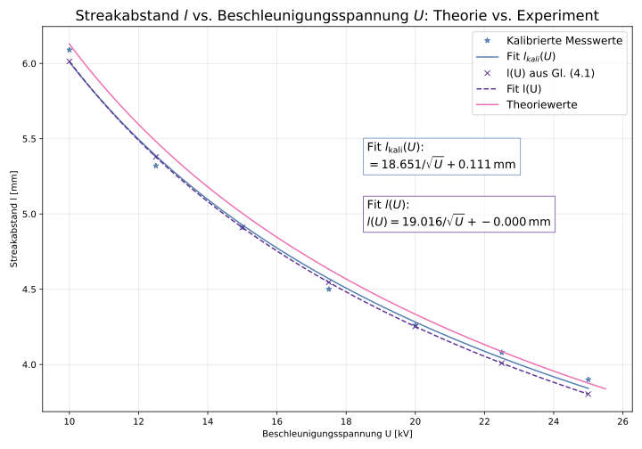
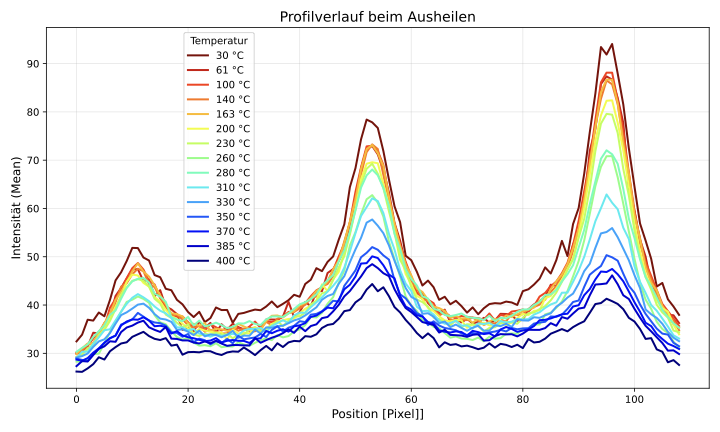

# Electron Diffraction on a Silver Surface (RHEED)

*Advanced lab course, FSU Jena · Dec. 2025 · with Lisa · supervisor: Dr. M. Grünewald*
**Grade: 1.23** (theory test 1.7 · experimental work 1.0 · report 1.0)

## The idea
Electrons are waves too. In **RHEED** (reflection high-energy electron diffraction) a beam of fast electrons grazes a crystal surface at a very flat angle and diffracts off the top atomic layers. The pattern on a fluorescent screen is a fingerprint of the surface: sharp streaks mean a smooth, ordered surface, spots mean a rough one. Because it works *during* growth, RHEED is a standard tool for watching thin films grow, atomic layer by atomic layer.

## What we did
In an **ultra-high-vacuum** chamber with a silver single crystal, Ag(100), we:
1. found the two high-symmetry directions of the crystal by rotating the sample,
2. varied the electron energy (10–25 keV) and the angle of incidence,
3. roughened the surface by **ion sputtering** and healed it again by **annealing**,
4. tested what the electron beam itself does to the surface,
5. **evaporated potassium chloride (KCl)** onto the silver and followed the growth of the new layer in real time.

## How I analysed it
- Fitted the streak spacing against voltage with the de Broglie relation, *l(U) = a/√U + b*, and compared calibrated data with theory.
- Turned RHEED screenshots into **intensity line profiles** and tracked peak height, background and mean intensity during annealing, electron irradiation and the two deposition phases.
- Compared the streak spacings of silver and KCl to work out how the two crystal lattices line up (epitaxial relation).

## Results
- Measured spacing and theory agree: the electrons behave as waves with λ ∝ 1/√U.
- After sputtering, the streaks broke up into spots (a rough 3D surface). After annealing, the streaks came back, sharper and with less noise than before.
- As KCl covered the surface, new KCl reflections appeared and the silver streaks faded, which is the signature of ordered, epitaxial growth.

