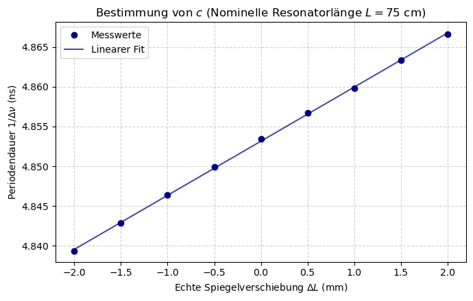
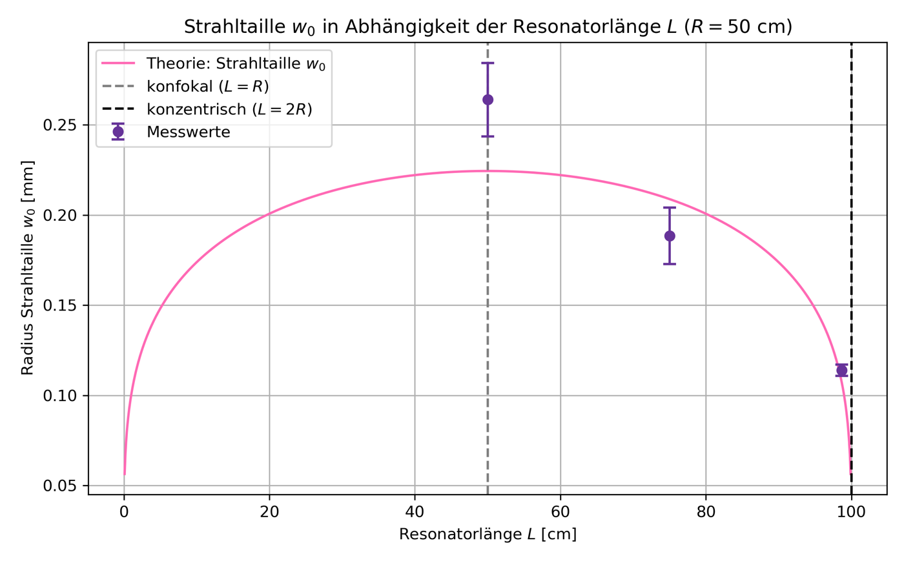

# HeNe Gas Laser

*Advanced lab course, FSU Jena · Apr. 2026 · with Nelly · supervisor: Dr. J. Hein*
**Grade: 1.33** (theory test 1.0 · experimental work 2.0 · report 1.0)

## The idea
A laser is a light amplifier between two mirrors. The mirrors decide which light patterns can survive: **transverse modes** (the beam's cross-section, from a single spot to several lobes) and **longitudinal modes** (the exact frequencies that fit as standing waves between the mirrors). In this experiment the resonator is open, so you can move the mirrors yourself and see how the beam changes.

## What we did
- Aligned the open helium-neon resonator and produced **transverse modes up to TEM₄₀** and measured the output power of each mode.
- Measured the **beam radius** inside and outside the resonator for several resonator lengths, to find the beam waist.
- Measured the **beat frequency between neighbouring longitudinal modes** (around 200–300 MHz) while moving one mirror over ±2 mm.

## How I analysed it
- Modelled the beam as a **Gaussian beam** and propagated it with **ABCD matrices**. The output mirror acts as a weak diverging lens, and including it was essential: a simple free-space model gave waists that were systematically too small.
- **Linear regression** of the inverse beat frequency against mirror position for two resonator lengths, with full error propagation. The slope gives the speed of light, the intercept the effective optical length of the resonator.

## Results
- **Speed of light: c = (2.98 ± 0.03)·10⁸ m/s**, in agreement with the defined value.
- The optical resonator length is longer than the measured one, because light travels slower in the mirrors, Brewster windows and gas.
- Output power drops almost linearly with mode order, from **0.40 mW (TEM₀₀)** to 0.01 mW (TEM₄₀): higher modes lose more light at the aperture.

