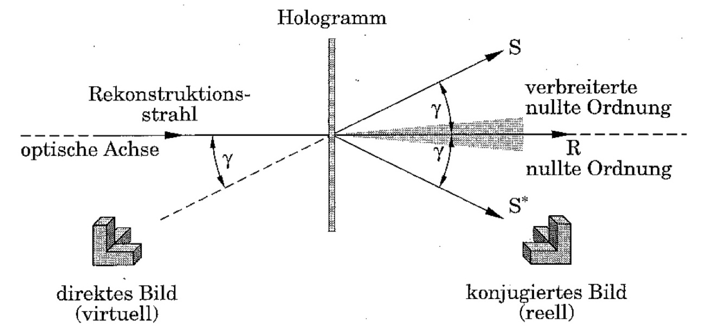
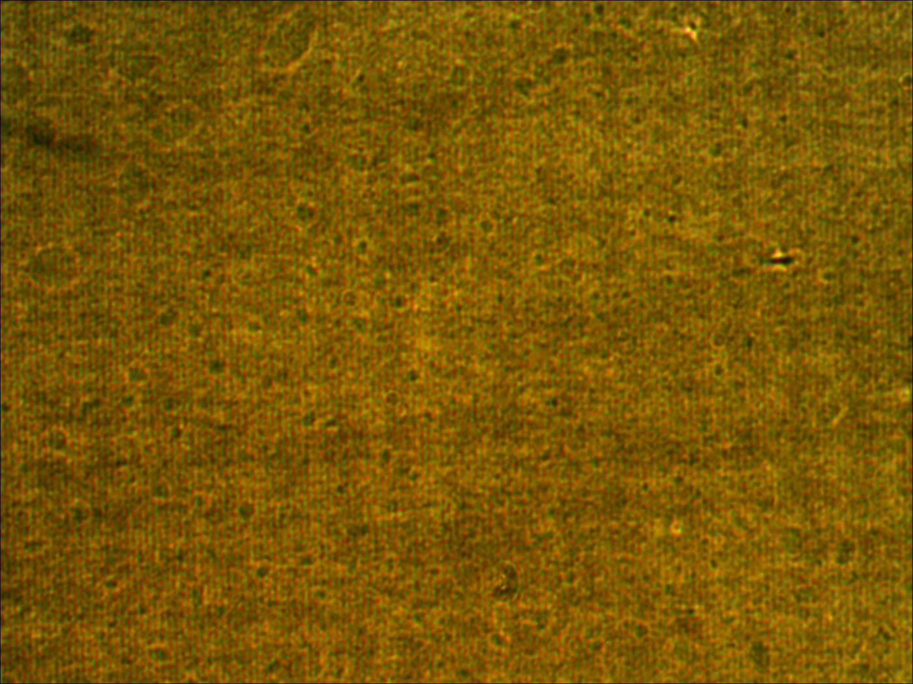
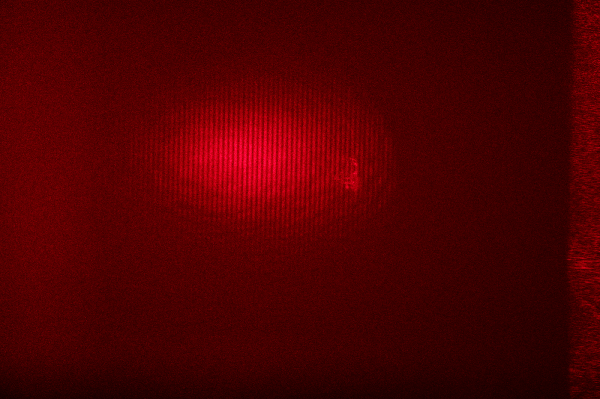

# Holography

*Advanced lab course, FSU Jena · Nov. 2025 · with Lisa · supervisor: Dr. S. Schmidl*
**Grade: 1.33** (theory test 1.3 · experimental work 1.5 · report 1.2)

## The idea
A normal photo stores only how bright the light is. A **hologram** also stores the *phase* of the light, by letting the light scattered from an object interfere with a clean reference beam on a photographic plate. The plate records a fine interference pattern, a kind of complicated diffraction grating. Shine the reference beam through it again and the original light field is rebuilt: you see the object in 3D, with real depth and parallax.

## What we did
- Built a **Michelson interferometer** to test how stable our optical table was and how coherent the HeNe laser (632.8 nm) is. Even a path difference of a whole table length stayed within the coherence length.
- Cleaned up the laser beam with a **spatial filter** to get even illumination.
- Recorded **transmission holograms** of glass objects and of a reflecting bust of Schiller, **white-light reflection holograms** that you can view in daylight, and a **holographic sine grating**. We developed all plates ourselves in the darkroom.
- Used **holographic interferometry**: two exposures of the same object, slightly tilted in between. The fringe pattern (59 fringes) gives the tilt angle with interferometric precision.

## Results
- The sine grating's period, measured two independent ways, agrees very well:
  - from the angle of the first diffraction order: **g = 0.860 ± 0.003 µm**
  - by looking at the grating under the microscope: **g = 0.864 ± 0.014 µm**
- The white-light holograms shine green to blue, although they were recorded with red light. The developing chemistry made the emulsion shrink, so the recorded layers sit closer together and reflect shorter wavelengths.

  
  

