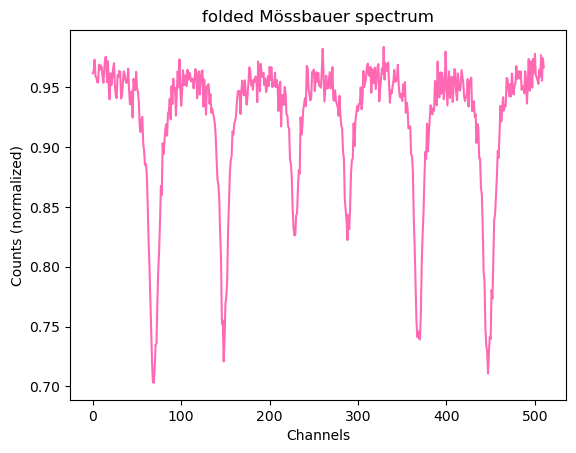
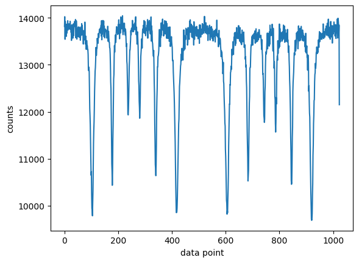

# Mössbauer Spectroscopy of Iron and Stainless Steel

*Advanced lab course, FSU Jena · May 2026 · with Nelly · supervisor: Dr. S. Sadashivaiah*
**Grade: 1.1** (theory test 1.0 · experimental work 1.0 · report 1.3)

## The idea
A ⁵⁷Co source emits gamma rays of exactly 14.4 keV, which iron-57 nuclei in a sample can absorb, but only if the energies match perfectly. The match is so sharp that the tiny shifts caused by the atom's surroundings decide whether absorption happens. By moving the source back and forth at a few mm/s, the Doppler effect scans the gamma energy across those shifts. The resulting spectrum shows the **magnetic field at the nucleus**, the **chemical environment** and the **symmetry** of the crystal around it.

## What we did
- Estimated the radiation dose and recorded the **energy spectrum of the ⁵⁷Co source** with a proportional counter and multichannel analyser.
- Set the electronic window onto the **14.4 keV Mössbauer line**.
- Recorded Mössbauer spectra of **pure iron** with two drive modes (constant acceleration and sinusoidal) and of **stainless steel** over 3.5 hours.

## How I analysed it
- **Own Python analysis** (`möss_auswertung.ipynb`): folding the raw spectrum, peak finding and a fit with six Lorentzian lines.
- **Velocity calibration and full transmission fits with [Nuclear NEXUS](https://fs-mcp.pages.desy.de/nuclear-nexus/)**, DESY's software for nuclear resonant scattering. The notebooks are based on the official NEXUS example for evaluating a Mössbauer spectrum. For the sinusoidal drive we corrected for the source spending more time near its turning points.

## Results
- Pure iron shows the classic **six-line (sextet) pattern**: the nuclear levels are split by a strong internal magnetic field, while the cubic crystal produces no quadrupole splitting.
- **Stainless steel** consists of **82 % non-magnetic** phase (a doublet) and **18 % magnetic** phase (a weak sextet with a reduced field of 20.9 ± 0.1 T). Its lines are about six times broader, because every iron atom in the alloy sees a slightly different neighbourhood.
- Triangular drive gives a flat baseline but shakes the setup at the turning points; sinusoidal drive runs smoothly but needs the baseline correction above.

