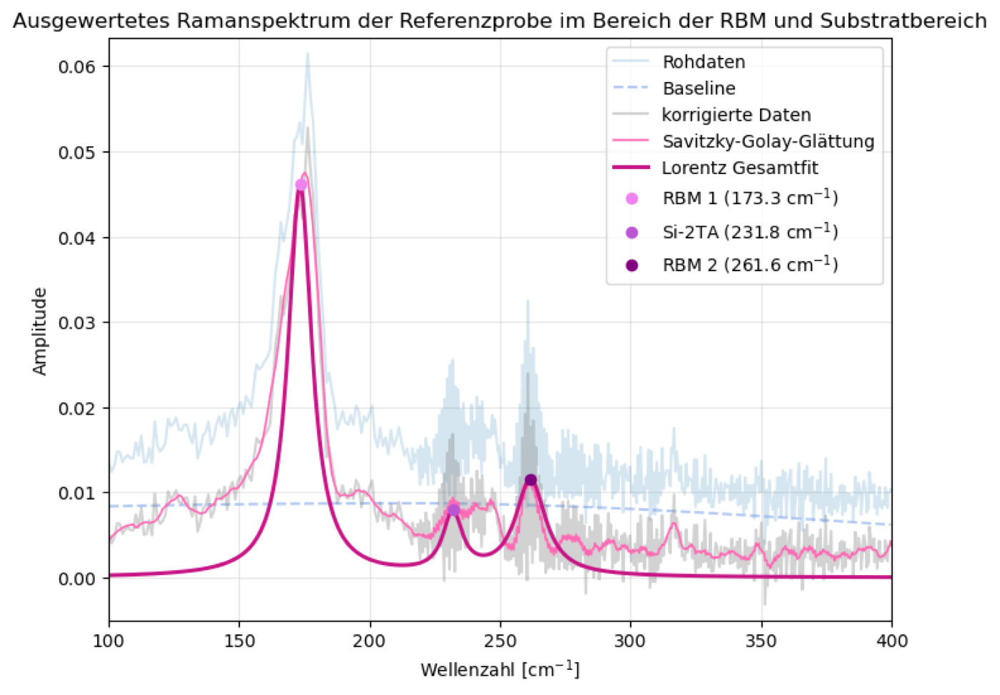
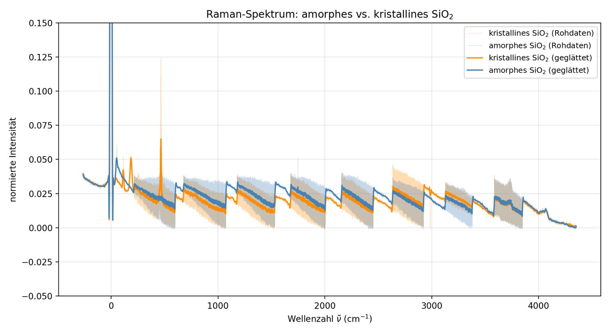

# Raman Spectroscopy of Carbon Nanostructures

*Advanced lab course, FSU Jena · June 2026 · with Nelly · supervisor: Dr. M. Grünewald*
**Grade: 1.67** (theory test 1.3 · experimental work 2.0 · report 1.7)

## The idea
When laser light hits a material, a tiny fraction comes back with a slightly different colour: it has given energy to (or taken energy from) a vibration of the atoms. This is **Raman scattering**. Every material vibrates in its own way, so the spectrum is a fingerprint. For **carbon nanotubes** it tells you even more: the "breathing" vibration of the tube depends directly on its diameter.

## What we did
- Calibrated a **Raman microscope** and found the best exposure time.
- Measured **carbon-nanotube** samples at several positions to judge their quality, density and homogeneity.
- Ran the **chemical vapour deposition (CVD)** process to grow nanotubes ourselves. Our own runs did not yield usable tubes, so the nanotube analysis is based on reference samples.
- Compared **amorphous and crystalline quartz (SiO₂)**, graphite and an **aspirin** tablet.

## How I analysed it
- **Baseline correction** with asymmetric least squares (sparse matrices), **Savitzky–Golay smoothing** and automatic peak finding.
- Single and **multi-Lorentzian fits** of the RBM, D, G and 2D bands.
- Peak ratios as quality measures: I_D/I_G for defects, I_G/I_Si for the local density of tubes.
- Tube diameter from the breathing-mode frequency, *d = 248 nm·cm⁻¹ / ω_RBM*.

## Results
- Breathing modes at 173 cm⁻¹ and 262 cm⁻¹ give tube diameters of **≈ 1.43 nm and ≈ 0.95 nm**.
- The **G band splits** in nanotubes but not in graphite, a direct effect of rolling a graphene sheet into a cylinder.
- Amorphous quartz glass gives a broad, smeared spectrum, crystalline quartz sharp peaks: long-range order is visible in the spectrum.
- The main aspirin bands could be assigned to the functional groups of acetylsalicylic acid.

