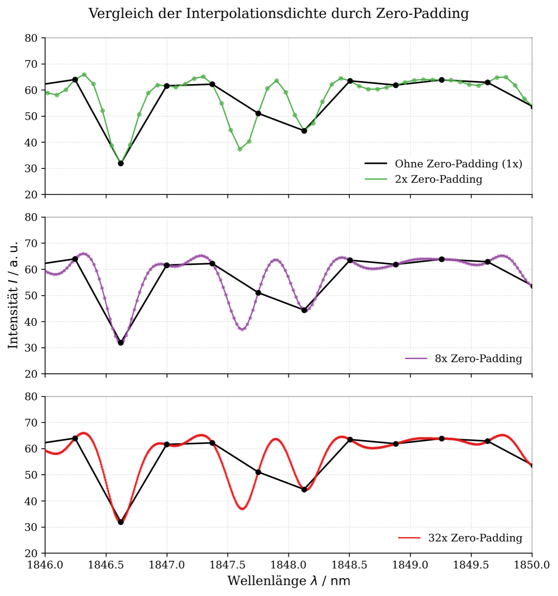
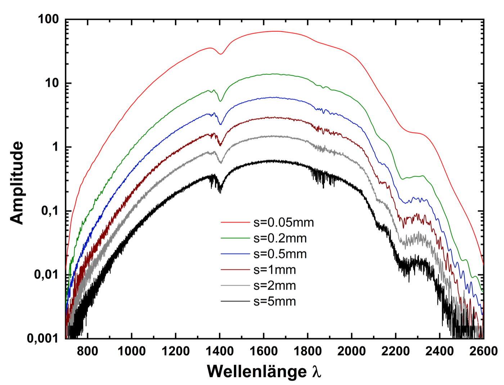
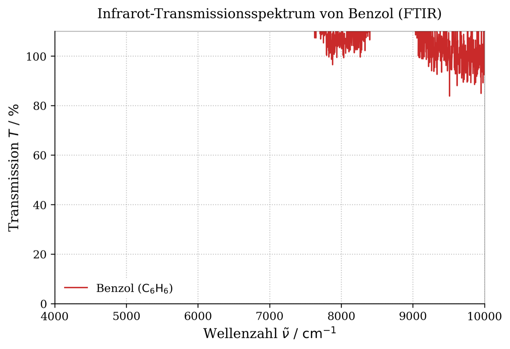

# Seminar: Optical Fourier-Transform Spectroscopy

*Seminar, FSU Jena · July 2026 · individual project: measurements, analysis and talk · supervisor: Dr. S. Schmidl*

## The idea
A **Fourier-transform spectrometer** never looks at colours directly. It sends light through a Michelson interferometer, moves one mirror and records how the brightness changes: the *interferogram*. A Fourier transform turns this signal into the spectrum. The approach collects far more light than a grating spectrometer and measures all wavelengths at once, which is why FTIR instruments are standard in chemistry and materials science.

## What I did
- Wrote the analysis that turns **interferograms** of a sodium lamp and a tungsten lamp into spectra with the FFT.
- Measured the **sodium D doublet** (589.0 nm and 589.6 nm) with different mirror travel distances to find the **resolution limit**. Theory says the two lines separate at an optical path difference of about 0.6 mm (Δν̃ ≈ 17 cm⁻¹). I compared this with spectra recorded at different mirror travels.
- Studied how **apodisation** (a triangular window) and **zero-padding** change the spectrum.
- Compared the **tungsten-lamp spectrum** with Planck's law for a black body at about 2700 K, and with an LED.
- Recorded the **near-infrared transmission spectrum of benzene** with an FTIR system and compared it with published data.
- Presented the results in a 28-slide seminar talk.

  
  

