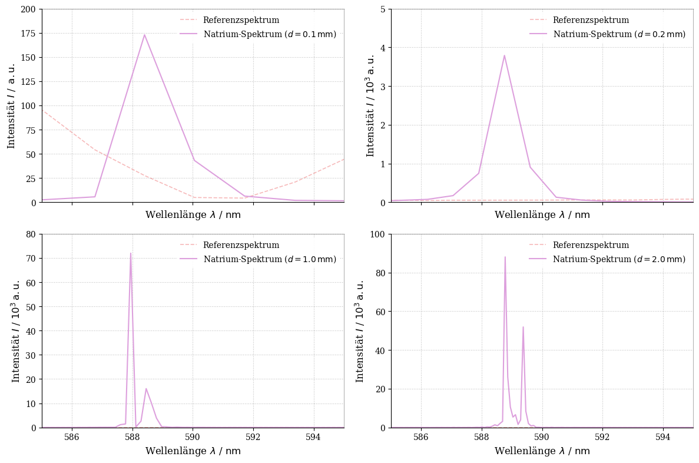
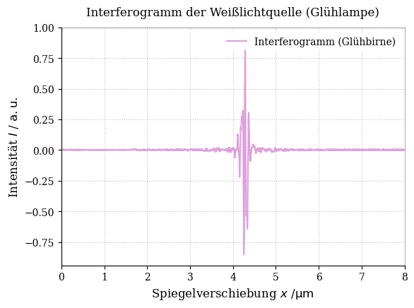
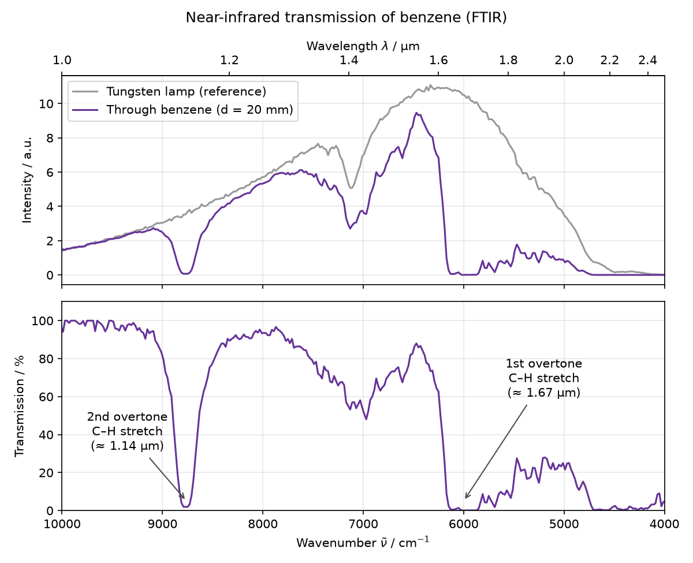
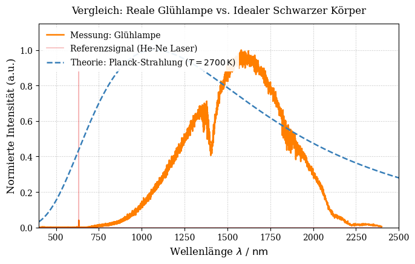
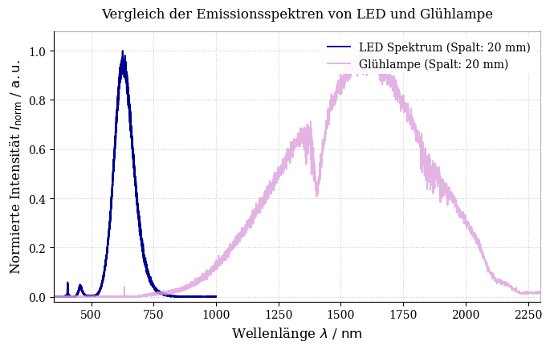

# Optical Fourier-Transform Spectroscopy – Fundamentals and Applications

*Seminar project, FSU Jena · 2026 (about six months, talk in July) · individual project · supervisor: Dr. S. Schmidl*

I chose this topic myself and worked on it for about half a year next to my other courses: planning and running the measurements in the lab, writing the analysis and presenting everything in a 28-slide seminar talk.

<em>The key result: with more mirror travel <b>d</b>, the single yellow sodium line splits into its two components, 0.6 nm apart.</em>

## The goal
A Fourier-transform (FT) spectrometer is one of the most widely used instruments in chemistry and materials science, yet it never measures colours directly. My goal was to understand it **from the ground up** and answer three questions with my own measurements:

1. **How does an interference signal become a spectrum?**
2. **What limits the resolution, and how far can it be pushed?**
3. **What can you actually measure with it?**

## 1 · From interferogram to spectrum
The instrument is a Michelson interferometer: the light is split in two, one mirror moves, and a detector records the brightness as a function of the mirror position. This signal, the **interferogram**, contains every wavelength at once. A **Fourier transform** separates them again into a spectrum.

White light gives a short, sharp burst: all wavelengths are only in phase when both arms are exactly equally long. Away from this point they cancel out. A single spectral line, like sodium, instead gives a long, regular oscillation.

## 2 · How fine can it resolve?
The longer the mirror travels, the finer the detail in the spectrum. The test case is the yellow **sodium D doublet** at 589.0 nm and 589.6 nm. To separate two lines Δν̃ ≈ 17 cm⁻¹ apart you need an optical path difference of about 1/Δν̃ ≈ 0.6 mm, i.e. roughly **0.3 mm of mirror travel**.

My measurements (top figure) show exactly this: at 0.1 and 0.2 mm the doublet appears as one peak, at 1 mm the two lines start to separate, and at 2 mm they are clearly resolved.

I also recorded the same spectra with different processing settings of the FTIR software and compared them:
- **Zero-padding** (adding zeros to the interferogram before the FFT) makes the spectrum look smoother, but it only interpolates between points. It does not add real resolution.
- **Apodisation** (a triangular window) suppresses the ringing side lobes around sharp lines, at the cost of slightly broader peaks.

## 3 · What can you measure with it?
- **A light bulb vs. a black body:** a tungsten lamp is a thermal emitter, so I compared it with Planck's law at about 2700 K. The measured spectrum is narrower than Planck's curve, because the detector and optics only cover roughly 0.8–2.4 µm; the dips at 1.4 µm and 1.9 µm come from water vapour in the air.
- **LED vs. light bulb:** the LED emits in a narrow band in the visible range, the lamp a broad continuum reaching far into the infrared.
- **Benzene:** with the lamp shining through a 20 mm benzene cell, the FTIR shows sharp absorption bands. They are the overtones of the C–H stretching vibration, the same molecular fingerprints that chemists use to identify substances. I compared the result with published near-infrared spectra.
- **Old vs. new instrument:** the same lamp measured with a classic FT spectrometer and a modern FTIR, to see how the instrument itself shapes the measured spectrum.

  
  

## Why FT spectroscopy is so popular
- **Throughput (Jacquinot) advantage:** no narrow slits, so far more light reaches the detector.
- **Multiplex (Fellgett) advantage:** all wavelengths are measured at the same time.
- **Precision (Connes) advantage:** a HeNe reference laser tracks the mirror position, so the wavelength axis is calibrated automatically.

## Files
- `analysis/`: Python analysis of the interferograms, the sodium resolution study, zero-padding/apodisation and the lamp, LED and benzene spectra (Jupyter notebooks), plus `benzene_transmission.py` for the benzene figure above
- `figures/`: the plots shown here
