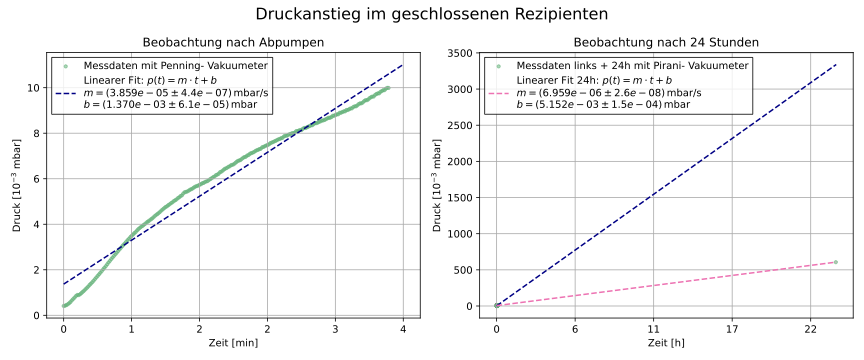
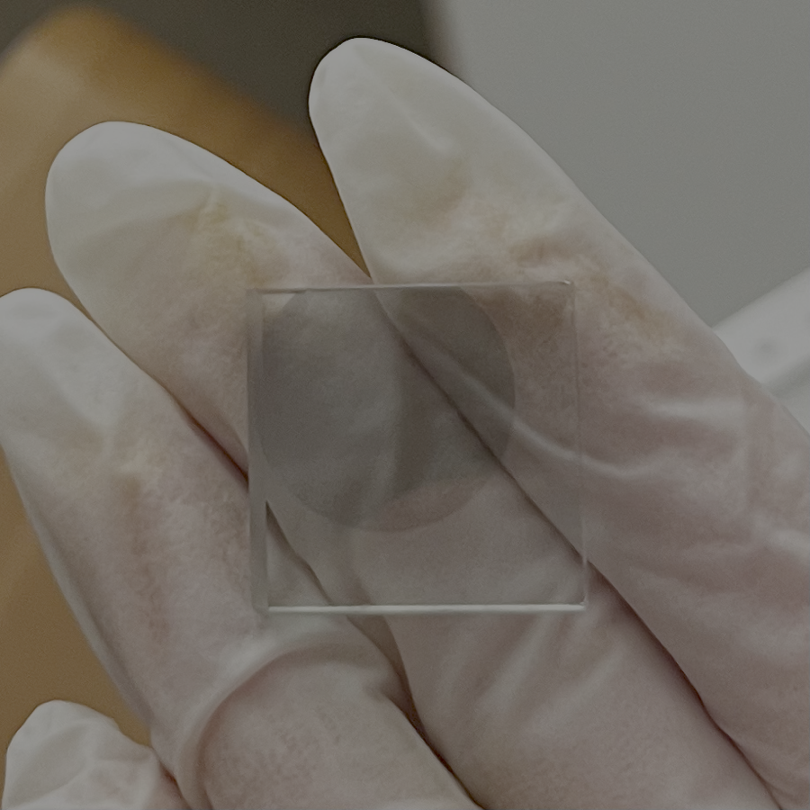
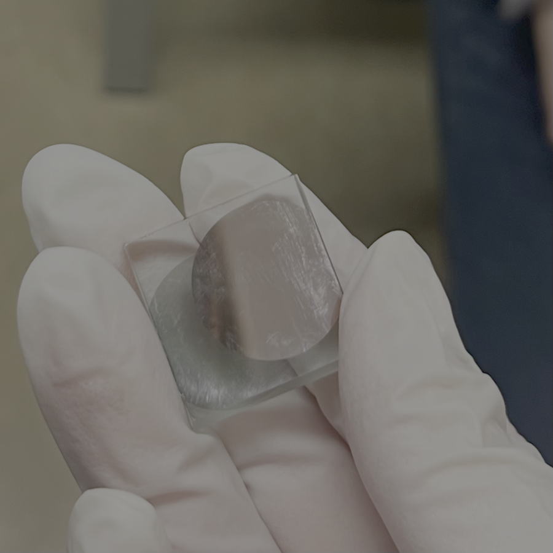
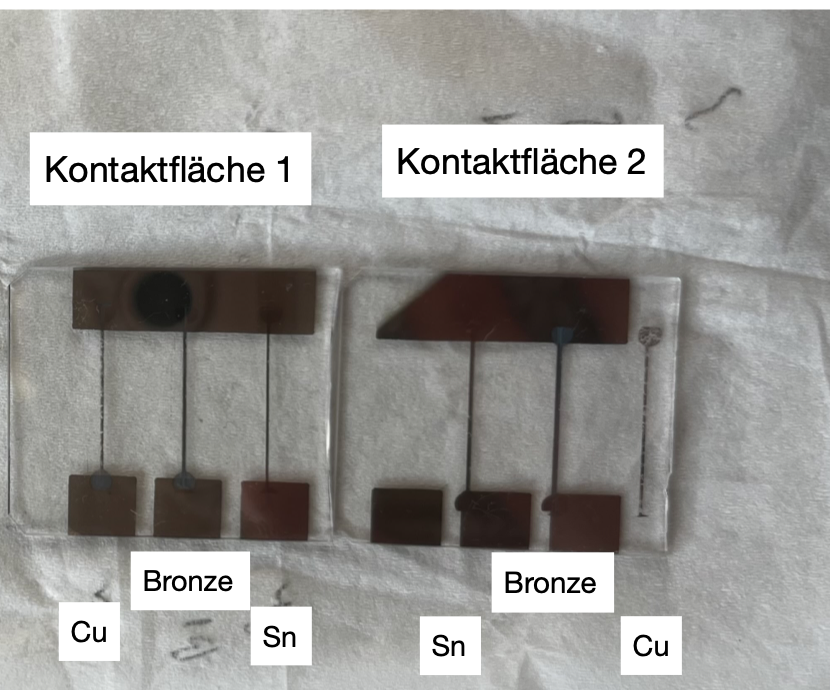
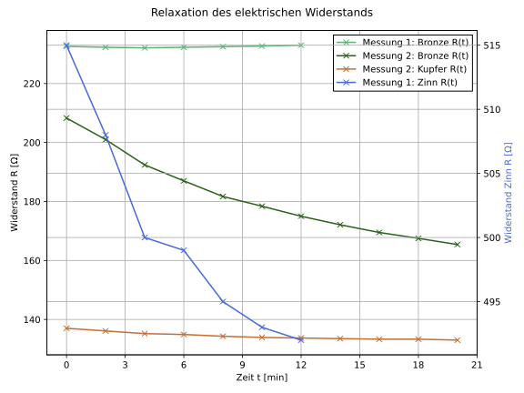

# Vacuum Technology and Thin-Film Evaporation

*Advanced lab course, FSU Jena · Jan. 2026 · with Lisa · supervisor: M. Thürk*
**Grade: 1.0** (theory test 1.0 · experimental work 1.0 · report 1.0)

## The idea
Almost every modern chip, mirror coating and quantum device is made in a vacuum. Without air, atoms evaporated from a hot source fly straight to a substrate and form a clean, thin film. This experiment covers both halves: **making a good vacuum** and **growing metal films** only nanometres thick, then checking how thick and how conductive they are.

## What we did
- Pumped down a vacuum chamber with a **rotary-vane pump** (rough vacuum) and a **turbomolecular pump** (high vacuum) and recorded the pressure over time.
- Closed the chamber and watched the pressure rise for 20 minutes and for 24 hours to find its **leak rate**.
- **Evaporated copper and tin** onto glass plates. We measured the film thickness *during* growth with a quartz-crystal balance and *afterwards* with an interference microscope over a masked step.
- Evaporated metal contact strips and recorded their **electrical resistance while the film was growing**.

  
  

<em>Copper evaporated onto glass. Left: our first film was so thin that it stayed transparent. Right: after a longer evaporation, a closed, mirror-like copper layer.</em>

<em>The two glass plates with evaporated contact strips (Cu, Sn and the Cu/Sn "bronze" layer) for the resistance measurements.</em>

## How I analysed it
- Exponential fits *p(t) = p_end + p₀·e^(−At)* of the pump-down curves to get the pumping speed of each pump.
- Linear fits of the pressure rise over short and long times to separate real leaks from virtual leaks (gas slowly escaping from surfaces).
- Resistance versus thickness and time for Cu, Sn and a Cu/Sn double layer.
- Sine fits to the interference-microscope fringes to measure the step height of the film.

## Results
- Pumping speeds: **3.94 L/s** for the rotary-vane pump and **71.7 L/s** for the turbomolecular pump.
- The pressure rise showed both real and virtual leaks.
- Comparing the two thickness measurements showed that the quartz balance's geometry ("tooling") factor had been set wrong. With the corrected factor, the thicknesses became consistent.
- Copper contacts only conducted from about **60 nm** thickness. A tin layer growing on copper acts as a parallel resistor and lowers the total resistance.

